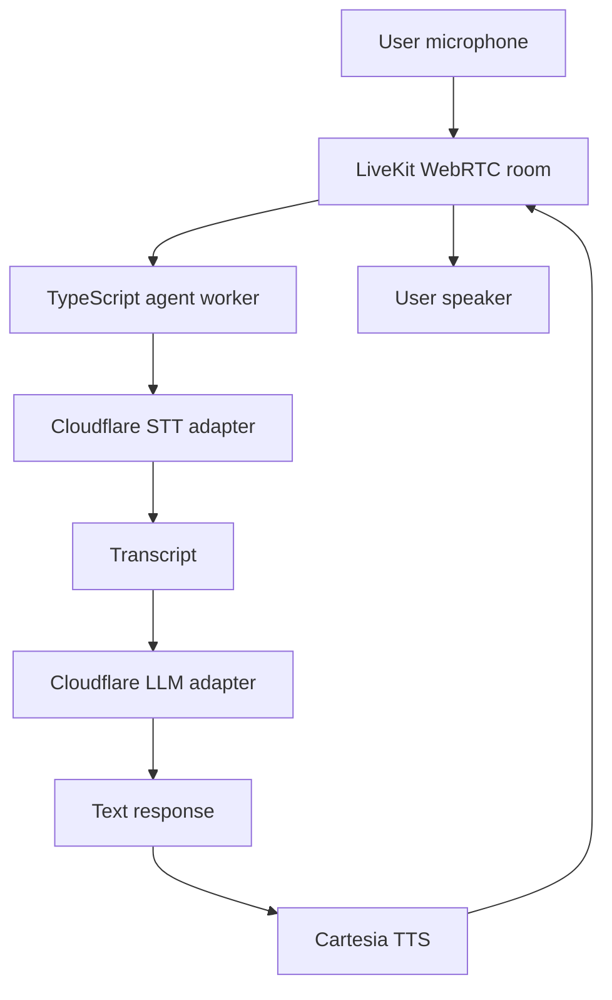
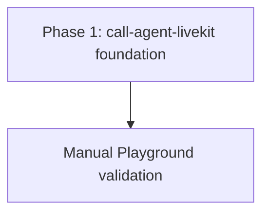

# Minimal LiveKit Cloudflare/Cartesia Voice Agent

## Goal and ownership

Build a standalone minimal LiveKit voice agent in `call-agent-livekit`. A user joins through LiveKit Playground, speaks over WebRTC, receives a greeting, and has a two-way conversation.

Ownership:

- `call-agent-livekit` — new TypeScript LiveKit agent worker and provider adapters.
- `call-agent` — excluded; no reuse or changes.
- `circuit` — planning artifact only; no implementation changes.

## Functional features

- Start a local TypeScript LiveKit agent worker.
- Let a user talk with the agent over a LiveKit WebRTC room.
- Greet the user when the session starts.
- Transcribe user audio through Cloudflare STT.
- Generate responses through the Cloudflare LLM endpoint.
- Synthesize responses through Cartesia TTS.
- End sessions cleanly when the user disconnects.
- Give a clear fallback response when a provider fails.

Explicit exclusions: database models, persistence, MongoDB, Redis, phone calls, Bolna, custom frontend, token server, application HTTP routes, deployment, and multi-agent workflows.

## Models and state

No application model is introduced.

```text
call-agent-livekit/
└── In-memory LiveKit AgentSession state  #REUSED — active room/session state only
    ├── connection status                 #WRITE
    ├── current conversation context      #WRITE
    └── provider error status             #WRITE
```

There is no collection, field migration, index, compatibility work, or persistent read/write operation.

## File tree

```text
call-agent-livekit/
├── .agents/
│   └── skills/                           #REUSED — Codex LiveKit guidance
├── skills-lock.json                      #REUSED — installed skill source lock
├── src/
│   ├── agent.ts                          #NEW — worker, session lifecycle, greeting
│   ├── providers/
│   │   ├── cloudflare-llm.ts             #NEW — Cloudflare OpenAI-compatible LLM adapter
│   │   ├── cloudflare-stt.ts             #NEW — Cloudflare audio-to-transcript adapter
│   │   └── cartesia-tts.ts               #NEW — Cartesia TTS provider wiring
│   └── config.ts                         #NEW — environment validation
├── .env.example                          #NEW — required local configuration
├── package.json                          #NEW — TypeScript and LiveKit dependencies
├── tsconfig.json                         #NEW — TypeScript configuration
└── README.md                             #NEW — local setup and Playground smoke path
```

## Routes and API contracts

No application HTTP routes are added or changed. LiveKit Playground supplies the WebRTC client and room connection for the first milestone.

| Method | Path | Auth/role | Request | Success response | Failure responses |
|---|---|---|---|---|---|
| N/A | N/A | N/A | No application request | LiveKit session audio | LiveKit/provider error handled in worker |

No route is removed. No REST compatibility contract is introduced.

## Services and validation

| Owner | Function | Arguments | Return | Side effects | Callers |
|---|---|---|---|---|---|
| Agent worker | Start voice session | LiveKit job context | Active session | Joins room and starts greeting | LiveKit |
| Cloudflare STT adapter | Transcribe user audio | Audio segment | Transcript | Calls Cloudflare Worker | Agent session |
| Cloudflare LLM adapter | Generate response | Transcript and session context | Text response | Calls Cloudflare endpoint | Agent session |
| Cartesia TTS provider | Synthesize response | Text response | Audio stream | Calls Cartesia | Agent session |
| Session lifecycle | Handle connect/end/failure | Session events | Updated in-memory state | Cleans up resources | Agent worker |

Validation and error handling:

- Validate required environment variables before the worker starts.
- Keep LiveKit, Cloudflare, and Cartesia credentials server-side.
- Reject empty or malformed provider responses.
- Apply provider timeouts and return a clear spoken fallback on failure.
- Stop the session cleanly on disconnect.
- No authorization, idempotency, database, or mutation rules apply in this milestone.

## E2E smoke path

### Successful conversation

Setup: Start the local worker with valid LiveKit, Cloudflare, and Cartesia configuration. Open LiveKit Playground and grant microphone access.

Action: Join a room, wait for the greeting, ask a question, and speak a follow-up.

Expected API/database result: No application API or database is involved. The worker receives LiveKit audio, obtains a Cloudflare transcript, obtains a Cloudflare response, and receives Cartesia audio.

Expected UI result: The user hears the greeting and two-way spoken responses in the Playground.

### Permission failure

Setup: Open LiveKit Playground and deny microphone permission.

Action: Attempt to join or speak.

Expected API/database result: No provider call is required and no persistent state changes.

Expected UI result: The client shows a microphone permission or unavailable-audio error.

### Configuration failure

Setup: Remove one required environment variable.

Action: Start the worker.

Expected API/database result: Worker refuses to start and makes no provider calls.

Expected UI result: No agent session is available; startup logs identify the missing configuration.

### Provider failure

Setup: Use an invalid Cloudflare or Cartesia credential/endpoint.

Action: Start a conversation and trigger the failing provider.

Expected API/database result: The adapter reports a timeout or provider error; no database write occurs.

Expected UI result: The agent speaks the configured fallback or ends the session safely.

### Disconnect

Setup: Start a successful conversation.

Action: Leave the LiveKit room.

Expected API/database result: The worker releases the active session; no persistent state changes.

Expected UI result: The room closes without an orphaned agent session.

## Flow diagram



## Delivery phases

### Phase 1 — `call-agent-livekit` foundation

Outcome: A local TypeScript worker joins a LiveKit room, greets the user, performs the Cloudflare STT → Cloudflare LLM → Cartesia TTS loop, and handles disconnects and provider failures.

Prerequisites: LiveKit credentials, Cloudflare STT and LLM endpoints, Cartesia credentials, and LiveKit Playground.

Verification: Run the successful conversation, permission, configuration, provider failure, and disconnect smoke cases above.

## Agent orchestration



Execution is sequential. No subagents are needed because the worker and provider adapters are tightly coupled and the project is intentionally minimal.

## Assumptions and risks

- The Cloudflare LLM endpoint exposes an OpenAI-compatible chat-completions contract.
- Cloudflare STT remains a custom adapter because its current audio endpoint is not a drop-in LiveKit OpenAI STT provider.
- Cloudflare STT may be turn-based rather than fully streaming, which can increase response latency.
- Cartesia is connected through its LiveKit TypeScript provider integration.
- LiveKit Playground is sufficient for the first WebRTC client; a custom frontend can be planned later.
- The implementation is in place. End-to-end provider verification still requires a running local LiveKit server and real Cloudflare/Cartesia credentials.
